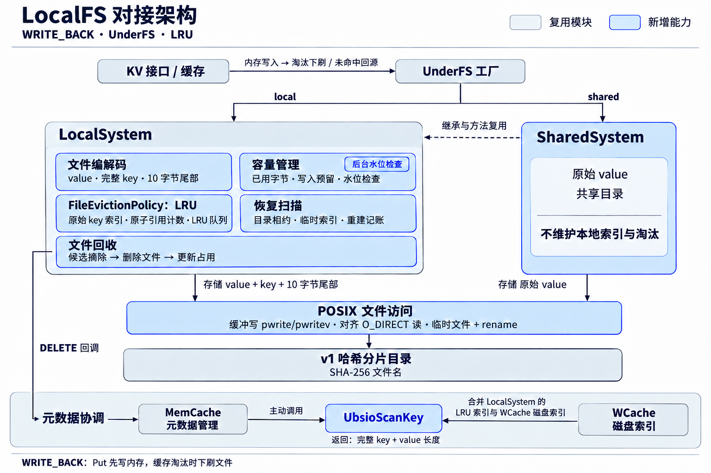
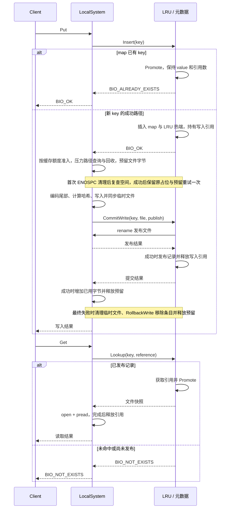
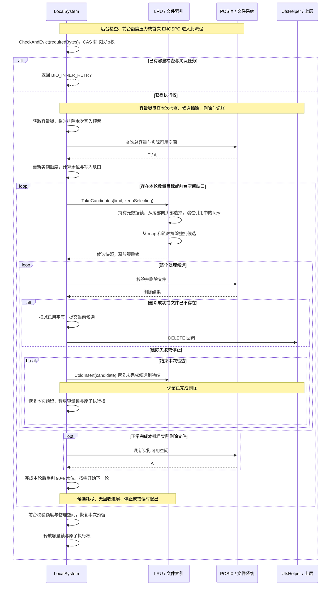

# LocalFS 对接设计

## 接入方式

LocalFS 复用 KV 接口、WRITE_BACK 下刷和 UnderFS POSIX 文件访问。
Put 将数据写入内存，缓存淘汰时下刷文件，缓存未命中时从文件回源。
在可运行的 standalone 配置上设置 `ubsio.underfs.file_system_type = local` 和 `ubsio.underfs.root_path` 即可启用。
最小配置见[本地文件系统后端示例](../standalone_mode_configuration.md#本地文件系统后端)，完整配置见[单机模式配置表](../standalone_mode_configuration.md#配置表)。

LocalFS 使用按 slot 隔离的缓存目录、进程内文件元数据索引和 LRU 淘汰。
LocalFS 与块设备缓存互斥，部署 local 时将 `ubsio.disk.path` 留空。
LocalFS 文件淘汰在本实例占用超过 90% 时触发，每轮按索引条目数量的 10% 向上取整回收，
轮次结束后重新判断水位；内存淘汰按内存配置执行。

## 架构

灰色表示复用模块，蓝色表示新增能力。上方为数据访问路径，底部为元数据协同；
虚线表示 SharedSystem 对 LocalSystem 的继承与方法复用。

## local 与 shared

UnderFS 工厂根据类型创建 LocalSystem 或 SharedSystem，SharedSystem 继承 LocalSystem。
公共方法提供哈希路径、临时文件、同步 POSIX 读写和 rename 发布；
local 管理文件元数据、索引、容量与淘汰，shared 读写共享目录中的原始 value。

| 行为 | local | shared |
| --- | --- | --- |
| 实现类 | [LocalSystem](../../ubsio-boostio/src/underfs/local_system.cpp) | `SharedSystem` |
| 目录归属 | 本实例独占 `slot_<id>`，持有目录内的 `.eviction.lock` | 由部署方保证相关 rank 可见 |
| 文件内容 | `[value][完整 key][11 字节固定尾部]` | 原始 value |
| 容量管理 | 文件系统总容量的 90% 按配置设备数均分，预留写入空间，按水位回收 | 由共享存储管理容量 |
| 文件定位 | 按原始 key 查询索引，再计算哈希文件名 | 按 key 计算哈希路径 |
| value 偏移与长度 | 从文件偏移 0 开始，Stat 返回 value 长度 | 从文件偏移 0 开始，Stat 返回文件长度 |
| 执行方式 | 调用线程同步执行，上层控制并发 | 调用线程同步执行，上层控制并发 |
| 上层元数据 | 主动扫描恢复，最终淘汰通知 DELETE | 由共享存储场景的上层元数据管理 |

同一 standalone 槽位分配域中的多个 local 进程共用配置文件和 root_path，
通过 StandaloneSlotLease 申请不同 slot，在各自的 `slot_<id>` 目录管理文件、索引、容量与回收。
`ubsio.standalone.device_count` 指定槽位数量，取值为 1–16，应与使用 LocalFS 的 local_service 进程数一致。
同一分配域使用相同的 `ubsio.standalone.device_count`；各实例按该配置值均分文件系统总容量，
slot 按需分配和释放时，容量分母保持稳定，未启动进程对应的份额保留。
不同容器命名空间中的分配域独立，应使用不同 root_path。

standalone 初始化顺序为申请 slot、初始化并恢复 UnderFS、发布槽位初始化就绪，再初始化后续缓存模块。
LocalFS 初始化失败时释放 slot；正常退出先停止 LocalFS、释放目录锁，再释放 slot。
slot 按空闲位置分配，进程重启后恢复当前获分配目录的数据，slot 与 worker/rank 不建立固定映射。
shared 的目录可见性、容量与租户配额由部署方管理。

## 文件格式

local 文件路径为 `root_path/slot_<id>/<SHA-256 前 2 位>/<接下来的 3 位>/<完整 SHA-256>.kv`。
shared 文件存放于共享目录，通过 SHA-256 两级分片及完整哈希定位。
`LocalFilePack` 编解码追加在 value 后的 key 和固定尾部。
文件布局为 `[value][完整 key][11 字节固定尾部]`，value 从文件偏移 0 开始，key 为 1–255 字节且不含 NUL。
固定尾部整数采用小端字节序。

| 尾部内字节偏移 | 长度 | 内容 |
| --- | --- | --- |
| 0 | 5 | magic：ASCII `UBSIO`，不含 NUL |
| 5 | 2 | `key_len`（uint16），完整 key 的字节长度 |
| 7 | 4 | `value_len`（uint32），value 的字节长度 |

尾部恰好 11 字节，仅包含 magic、key_len 和 value_len。
单个 local value 的长度范围为 0–4294967295 字节；超过 UINT32_MAX 的 Put 在文件写入前返回 `BIO_INVALID_PARAM`。
文件长度为 `value_len + key_len + 11`，无头部、独立 version 字段或对齐填充。
LocalFilePack 的长度参数、索引中的完整文件长度和容量记账使用 64 位表示，支持 value 与追加元数据的长度之和。
Get 的偏移相对于 value；Stat 和 key 扫描返回 value_len。
常驻索引保存完整文件长度，读取时根据索引 key 的长度扣除 `key_len + 11`，确定 value 边界。

恢复使用缓冲 I/O 读取文件末尾至多 266 字节，从最后 11 字节解析长度并提取其前的完整 key。
恢复按 11 字节尾部布局校验 magic、key 边界、value 长度、文件总长度及哈希路径。
损坏文件被移到同目录的 `.corrupt.` 前缀路径，扫描继续恢复其他 key。
实际 I/O 错误或已识别的旧版 header 文件使初始化返回 `BIO_UFS_IOERR`，原文件保持原路径和内容。
shared 文件的全部字节均为 value，读写从偏移 0 开始。
local 和 shared 分别使用符合各自文件格式的目录。

## 与 Mooncake FilePerKey 的比较

比较对象是 Mooncake 提交 `218f2ffdcf2ec10bca28c44af7ce994b18288cca` 中的
[StorageBackendAdaptor / FilePerKey](https://github.com/kvcache-ai/Mooncake/blob/218f2ffdcf2ec10bca28c44af7ce994b18288cca/mooncake-store/src/storage_backend.cpp#L1008)。
该路径通过 struct_pb 编解码包含完整 key 与 value 的 KVEntry。
LocalFS 同样在文件中保留完整 key，通过 value 在前、元数据在后的布局简化读路径。

| 项目 | Mooncake FilePerKey | LocalFS |
| --- | --- | --- |
| 文件内容 | KVEntry 的 protobuf 编码，包含 key 与 value | 原始 value、完整 key、11 字节固定尾部 |
| 写入数据准备 | ConcatSlicesToString 合并 slices，再 to_pb 生成编码缓冲区 | 多片 value 合并到对齐缓冲区，key 和固定尾部按块对齐写入 |
| 正常读取 | BatchLoad 读取编码内容，from_pb 解析，memcpy 将 value 复制到目标 slice | 按索引确定 value 长度，pread 直接读入调用方缓冲区 |
| Direct I/O 适配 | use_uring 开启时读文件使用 O_DIRECT；UringFile::read 通过 4096 字节对齐临时缓冲区读取后复制到字符串 | 请求缓冲区、实际读取长度和偏移均按 512 字节对齐时使用 O_DIRECT，文件偏移直接等于 value 内偏移 |
| 元数据恢复 | ScanMeta 读取完整编码文件并 from_pb 解析 | 每个文件读取尾部至多 266 字节，重建 key、value 长度和容量记账 |

LocalFS 对齐读取直接使用调用方缓冲区，正常 Get 路径只访问目标 value 范围，省去完整对象的反序列化与 value 中间复制。
偏移从 0 开始，使 key 长度不影响 value 的对齐；部分读取同样按 value 内偏移定位。
写入通过 iovec 追加小段元数据，无需为整个 value 构造序列化副本。
恢复读取量受 key 长度上限约束，不随 value 大小增长。

Mooncake 的上述行为可由
[BatchLoad 与 ScanMeta](https://github.com/kvcache-ai/Mooncake/blob/218f2ffdcf2ec10bca28c44af7ce994b18288cca/mooncake-store/src/storage_backend.cpp#L1101) 和
[UringFile::read](https://github.com/kvcache-ai/Mooncake/blob/218f2ffdcf2ec10bca28c44af7ce994b18288cca/mooncake-store/src/uring_file.cpp#L498) 复核。
比较范围为 FilePerKey 的适配层路径；Mooncake 的 Bucket 后端具备直接读取对齐 slice 并调整指针的路径，其行为另有实现。
两者的该文件写入均使用缓冲 I/O；LocalFS 的实际吞吐与延迟收益由相同设备、数据量和并发压力下的测量确定。

## 元数据所有权与恢复

`FileEvictionPolicy` 定义文件元数据、引用获取、写入发布和候选选择接口，
`lru_eviction_policy.cpp` 管理索引与队列。
职责划分如下：

| 模块 | 管理内容 |
| --- | --- |
| LocalSystem | 容量额度、正式文件已用字节、在途写入预留、文件系统空间与回收目标 |
| FileEvictionPolicy | 常驻文件 map、原子引用计数和 LRU 队列 |
| MemCache | 聚合元数据、文件副本路由和 Master 上报 |

常驻索引为 `原始 key → IndexedFile`。原始 key 由 map 的键持有，条目保存相对目录 leaf、正式文件总长度、
嵌入式队列节点和原子引用计数；队列节点借用所属 map 的 key。
单次写入与淘汰候选使用独立快照，快照随操作结束释放。
访问文件时按完整 key 计算 SHA-256，计算结果用于本次操作。
初始化加载 libcrypto.so 并解析 SHA256 符号，用于计算 key 的哈希文件名。

LocalSystem 初始化按以下顺序恢复：

1. 创建当前 slot 的数据目录，打开 `slot_<id>`，获取目录内 `.eviction.lock` 的独占锁。
2. 扫描匹配分片布局的普通 .kv 文件，读取文件尾部并校验 key、长度和哈希路径。
3. 在容量锁内确认写入预留为零，清理本目录中符合生成命名和哈希分片路径的普通临时文件，
   使用函数内临时 FileIndex 收集正式文件记录与总字节数。
4. 完整扫描成功后，策略原子接管临时索引，并按 map 遍历顺序逐个头插建立 LRU 队列。
5. 提交本 slot 的已用字节，执行水位检查，启动后台回收线程；standalone 发布槽位初始化就绪。

扫描或策略接管失败时保留已发布的索引和记账。
临时 FileIndex 的生命周期覆盖本次恢复；常驻索引由策略模块持有。
初始候选从尾部向头部的选择顺序与 map 遍历顺序一致，后续 Lookup 命中和 Insert 更新热度。
恢复扫描和 UbsioScanKey 的 LocalFS 快照均只覆盖当前 slot，其他 slot 的文件不进入本进程索引和上层元数据。
临时文件名为 `.tmp.<完整 SHA-256>.<六位字母或数字>`；恢复清理使用目录 fd 和不跟随符号链接的文件检查。
符号链接、目录、不匹配的临时文件和锁文件保留。临时文件没有已发布元数据，清理时不发送 DELETE 回调。
清理失败返回 `BIO_UFS_IOERR`，已发布索引和容量记账保持有效。只读恢复扫描保留临时文件。

## 写入与读取

WCache 的 LocalFS 下刷与 bypass 使用同一写入入口。WCache 按 value、key 和 11 字节尾部的总长度申请一块
512 字节对齐的缓冲区，将 value 拷入后通过 UfsPut 将原始长度和缓冲区容量传给 UnderFS。SharedFS 通过 UfsPut 写入连续的原始 value。
LocalSystem 的写入过程如下：

1. 校验 key、缓冲区与总长度，在容量锁内调用 Insert。
   map 已有 key 时将其移到 LRU 热端，直接返回 BIO_OK；保持原 value、容量和引用数。
2. 新 key 以未发布记录插入 map 和 LRU 热端，并持有一个写入引用。
   使用缓存额度、已用量和在途预留完成准入，预留整个新文件长度。
   超过缓存水位或剩余额度不足时，先计入本次预留，释放容量锁后调用 CheckAndEvict 查询实际空间并按需回收；
   准入失败时回滚新条目及本次预留。
3. 在 WCache 缓冲区的 value 末尾原地编码 key 和固定尾部，补零到对齐长度。
   计算哈希路径，在容量锁和策略锁外以 `O_DIRECT` 写同目录临时文件，再将文件截回实际长度。
   文件系统不支持该直写时，以缓冲 I/O 写同一块缓冲区中的实际数据。
4. 临时文件写入、`fdatasync` 和关闭成功后，LocalSystem 将 PublishFile 作为回调传入 CommitWrite，
   策略在元数据锁内调用该回调完成 rename，
   将文件位置和长度转入已插入的条目并释放写入引用。
   LocalSystem 增加已用字节并释放写入预留。提交保留 Insert 后的队列位置。
5. 创建临时文件或目录、写入、close、rename 首次返回 ENOSPC 时，先删除失败的临时文件，
   再查询文件系统空间并按需回收，随后重新写入和发布一次。系统调用处记录空间不足标记，
   后续 close、trace 和日志不参与错误类别判断。空间复查统一进入 CheckAndEvict，重试保留原占位条目和写入引用；
   空间复查排除本次已有预留，结束后保持原预留，避免同一文件重复计账。
6. 非 ENOSPC 错误、清理或空间复查失败、第二次写入发布失败时直接返回错误。
   WriteReservation 统一清理已创建的临时文件，
   RollbackWrite 从 map 和链表移除该条目，并释放写入预留。

重复 Put 以 map 中存在 key 为成功条件，包括尚在写入的 key；重复请求只提升热度。
已有 key 路径直接完成，不执行容量探测、序列化、路径哈希或文件 I/O。
Get 和 ScanKeys 仅返回已发布文件，首次写入完成前查询该 key 返回未命中。

Get、Exist 和 Stat 在策略元数据锁内定位条目并获取引用，Lookup 命中后立即提升到 LRU 热端。
引用覆盖文件定位后的 open、pread 或 stat，操作结束时原子释放。
LRU 热度在索引命中时更新；文件访问的返回码由相应接口报告。
Get 要求读满请求长度，GetWithRealLen 输出实际读取长度，进入接口时将输出长度初始化为 0。
local 将读取范围限制在 value_len 内，追加的 key 与尾部不返回给调用方。
非空请求从 value 末尾或其后开始时返回 BIO_READ_EXCEED；跨越 value 末尾时，Get 返回 BIO_READ_EXCEED，
GetWithRealLen 返回 BIO_OK 并输出剩余 value 长度。

LocalFS 用 `pwrite` 提交 512 字节对齐的直接写入。SharedFS 用 `pwrite` 写原始 value。
读取在缓冲区地址、实际读取长度和 value 内偏移均满足 512 字节对齐时使用 O_DIRECT，其他请求使用缓冲 I/O。
local 和 shared 的实际文件偏移均等于 value 内偏移；local 按 value 边界截断后的实际长度参与对齐判断。
O_DIRECT 依赖底层文件系统支持对应对齐要求；文件打开或读取失败时返回相应错误码。
写入使用返回的实际字节数推进偏移，收到 EINTR 时重试。
调用返回后，调用方可以复用缓冲区。

LocalFS 每个文件在发布前完成一次 `fdatasync`，恢复时同步有效文件后再纳入索引。
NDS 按已发布文件定位数据。SharedFS 文件发布在写入和关闭完成后执行 rename。
WRITE_BACK Put 的完成条件为内存写入完成。

## 引用计数与锁

LRU 队列头部为热端，尾部为冷端。Insert 和 Promote 使用 LinkHead，ColdInsert 使用 LinkTail。
TakeCandidates 从尾部向头部选择候选，跳过仍有引用的条目。

多个读请求可以同时持有同一条目。新 key 从 Insert 到提交或回滚持有一个引用。
重复 Put 只提升已有条目，直接返回成功，保持引用数。
新占位的文件长度为 0，已进入 LRU 队列，由写入引用保护；Lookup 和扫描将其视为未发布。
显式删除引用中的 key 返回 `BIO_INNER_RETRY`。

CommitWrite 在文件发布成功后使记录可查询；Remove 从 map 和 LRU 队列移除记录，
返回供文件层删除的快照。
TakeCandidates 在元数据锁内选择引用数为 0 的冷端条目，形成完整快照，
随后直接从 map 和 LRU 队列摘除整批候选，再释放策略锁。
引用数非零的条目被跳过。候选摘除后，查询、遍历和后续候选选择均无法看到该批 key。
候选快照在策略锁外交给文件层处理。

| 锁 | 保护范围 |
| --- | --- |
| 生命周期读写锁 | 数据和元数据调用持读锁，Init、Stop 持写锁 |
| 容量锁 mEvictionMutex | 恢复、空间检查、写入预留、发布记账、回滚及文件删除 |
| 策略元数据锁 | 文件 map、引用获取、LRU 链表结构、热度更新、候选摘除及 rename 发布边界 |
| 回调锁 | 回调注册、暂存事件投递和直接回调调用 |

嵌套加锁顺序为 `容量锁 → 策略元数据锁`。
容量锁覆盖候选摘除至物理删除完成的区间，串行化该区间内的写入预留。
文件数据读写在容量锁和策略锁外执行；rename 发布持策略元数据锁，文件删除在策略锁外执行。

每个 LocalSystem 通过原子变量 mEvictionInProgress 控制一次容量检查与淘汰任务。
初始化、Put 压力路径、ENOSPC 复查和后台循环共用 CheckAndEvict：先 CAS 获取执行权，再获取容量锁。
已有任务时返回 BIO_INNER_RETRY，不等待容量锁或重复查询文件系统；后台跳过本轮，前台回滚本次新写入并返回上层。
只有获取执行权的调用通过作用域守卫释放标志；错误、停止和提前返回均释放该调用持有的执行权。
原子变量控制任务准入，容量锁继续保护预留、记账和候选摘除后的 key 复用边界。

`.eviction.lock` 在实例初始化时使用 `flock(LOCK_EX | LOCK_NB)` 获取，
获取失败使初始化返回 `BIO_UFS_IOERR`。
实例存活期间持有该目录锁，Stop 关闭持锁 fd。该锁用于同一 slot 目录的独占校验，
不同 slot 的目录锁相互独立。

读写由上层 PT 或 SDK worker 在各自调用线程中执行。
Stop 等待在途调用退出，结束后台水位线程，再释放目录、文件索引及回调资源。
停止后，读写和按 key 的元数据接口返回 `BIO_NOT_READY`；重新初始化执行文件恢复。

## 容量与水位

文件系统总量 T 和当前用户可用量 A 通过 fstatvfs 获取。
N 为配置项 `ubsio.standalone.device_count` 的值，经 BioServer、UfsHelper 和 UnderFS C 接口以 deviceCount 传入。
可管理总容量 M 为 `floor(T × 90 / 100)`，每个 LocalSystem 的额度 C 为 `floor(M / N)`。
初始化、前台空间复查和后台容量检查均通过 CheckAndEvict 按此公式更新 C，totalCapacity 上报缓存的 C。
容量折算比例由 FILESYSTEM_CAPACITY_PERCENT 控制，淘汰触发水位由 EVICTION_HIGH_WATER_LEVEL 控制，
两者是 LocalSystem 内部的独立常量，均为 90%；前者作用于 T，后者作用于 C。
slot 目录按需分配，当前已分配或占用的 slot 数量不参与额度计算。
U 表示正式文件已用字节，R 表示在途预留，S 表示本次新文件长度，三者均按 value、完整 key 与 11 字节固定尾部的总长度计算。

| 配置 | 生效行为 |
| --- | --- |
| `ubsio.standalone.device_count` | 容量均分的配置设备数及 slot 分配上限，默认 1，取值 1–16 |
| `ubsio.underfs.eviction.check_interval_seconds` | 后台检查间隔，默认 10 秒 |

每个 LocalSystem 在 `U + R > floor(C × 90 / 100)` 时启动一轮淘汰，等于阈值时保留文件。
例如文件系统总容量为 100 GiB、配置设备数为 1 时，totalCapacity 为 90 GiB，淘汰触发阈值为 81 GiB。
轮次开始时调用 FileEvictionPolicy::Size() 获取当前 map 条目数 K，目标为 `ceil(K / 10)` 个 key；
K 大于零时至少选取一个。K 包含在途写入占位，已摘除候选不计入 K。
LRU 从冷端尽量选满数量目标，跳过引用中的文件；在途新写入由写入引用保护。

每轮结束后重新计算本实例占用。仍超过 90% 时，按当前索引条目数开始下一轮；
达到 90% 及以下、候选耗尽、停止或本批没有回收进展时结束本次检查。
单轮目标按 key 数量计算，文件大小不同会影响释放的字节数；本次调用中的轮次按实际结果连续推进。
每个实例的写入预留、已用记账和回收目标均由本进程管理。

正常新增 key 使用缓存 C 检查 `U + R + S <= C`，不调用 fstatvfs。
`U + R` 超过 90% 水位或 `U + R + S > C` 时，前台先预留 S，再释放容量锁并进入 CheckAndEvict。
该入口统一查询 T、A，刷新 C、判断水位、执行回收并校验写入空间。
首次 ENOSPC 同样进入该入口；持有容量锁期间临时排除本次预留，以下计算中的 R 仅包含其他在途写入。
检查结束后恢复本次预留，失败由写入路径释放；本次 S 不重复计入 R。
前台压力路径同时回收满足 `U + R + S <= C` 和 `R + S <= A` 所需的字节数。
`R + S > A` 时，物理空间缺口为 `R + S - A`。
本批选择持续到本轮数量目标及本次写入字节缺口均已满足，或达到单批上限，
回收数量可因写入缺口超过本轮比例目标。
U、R 是按文件长度计算的逻辑记账，A 是整个文件系统的瞬时可用量；
正常路径不把实例剩余额度当作物理可用量，实际文件访问的 ENOSPC 由有限重试处理。

前台单批至多选取 1024 个文件，后台单批至多选取 128 个；一轮可以分成多个批次完成。
每批生成有限候选快照并完成文件处理，控制临时 key 副本数量。
初始化、后台检查、前台额度压力及首次 ENOSPC 查询文件系统空间。
每个正常完成且实际删除文件的批次刷新一次 A，前台压力路径复用快照完成额度与物理空间检查。
首次准入成功后预留 S；ENOSPC 复查保留原有预留，第二次尝试不再申请额度。
S 大于 C，或 R 加 S 已超过 C 时，直接返回 `BIO_UFS_IOERR`；
空间检查失败或回收后仍无法容纳时，写入返回错误码并回滚本次新条目。

## 淘汰与显式删除

LRU 从冷端选择引用数为 0 的文件，在途新写入由写入引用保护。
LocalSystem 管理本轮剩余 key 数与本次写入字节缺口，策略按数量上限、引用和队列顺序形成完整批次。
文件层通过目录 fd、O_NOFOLLOW 和普通文件检查，逐个删除已摘除的候选。

候选长度在摘除后继续计入 U；物理删除成功或确认文件已不存在后，逐个扣减并发送 DELETE。
删除失败或停止时，未完成候选恢复到索引和 LRU 冷端，其容量记账继续保留。
显式 Delete 调用 Remove，再执行文件删除；失败时通过 ColdInsert(candidate) 恢复记录和查询可见性。

本批正常结束且至少实际删除一个文件时，刷新一次实际可用空间。
`deletedFileBytes` 统计成功 unlink 的文件长度之和，包含 value、完整 key 和固定尾部；
物理空间释放以文件系统可用量为准。其他程序占用和仍被打开的已删除文件均体现在实际空间检查中。
回收范围为本实例索引中的文件。

前台额度压力、首次 ENOSPC 和后台水位检查共用以下单批候选摘除与文件删除流程。
CheckAndEvict 的原子执行权覆盖容量探测与完整回收过程，直到写入空间校验结束。
LocalSystem 在同次调用中分批完成本轮数量目标，轮次结束后重新判断 90% 水位，决定是否开始下一轮。
本轮剩余 key 数和写入空间缺口属于本次调用的局部计算；物理空间检查用于本次前台写入。
容量锁贯穿空间检查、候选摘除、文件删除与记账；策略元数据锁覆盖候选选择与索引、链表变更。
候选摘除后立即不可查，文件访问与上层回调在策略锁外执行。
删除失败时恢复当前及后续未完成候选，已完成的删除与容量扣减保持生效。

## 上层元数据恢复与删除事件

UBS IO 初始化完成后，MemCache 通过 UbsioScanKey 获取存量元数据。
扫描通过 [Cache::ScanDiskKeys](../../ubsio-boostio/src/cache/cache.cpp) 收集 WCache 的磁盘索引，
再通过一次 UfsScanLocalKeys 获取全部 local 已发布文件索引快照，
按完整 key 合并去重，重复 key 使用 WCache 的记录。
结果一次返回，hasMore 为 false；每条记录包含完整 key 和 64 位 value 长度，长度扣除 local 的 key 与固定尾部。

扫描遍历已发布的索引记录，过滤新占位和已摘除候选，保留 LRU 顺序。
扫描失败返回错误码并清空合并结果。
UfsHelper 使用 free 释放底层扫描快照，上层通过对应的 FreeScanKeyResult 接口释放公开扫描结果。

应用通过 UbsioKvCacheRegisterMetaEventCallback 注册、更新或注销回调。
Cache 将同一个回调交给 WCacheManager 和 local 的 UfsHelper。
local 文件最终淘汰成功或确认已不存在时，UfsHelper 将事件转换为 UBSIO_META_DELETE，携带完整 key 调用回调。
内存下刷属于缓存内部迁移，上层保留对象元数据；WCacheManager 按 UnderFS 配置过滤相应的下刷 DELETE。

[UfsHelper](../../ubsio-boostio/src/underfs/ufs_helper.h) 在回调为空时暂存删除事件，
注册非空回调时按顺序一次投递暂存事件并释放暂存容量。
回调在锁内调用，上层在回调中复制 key 并投递到自身队列，负责聚合元数据清理、Master 上报与重试。
回调执行期间遵守锁顺序，并通过队列将后续 UnderFS 访问移到回调之外。
退出阶段先完成缓存下刷和 local 回收，再排空 WCache reporter；上层完成自身事件队列的排空与停止。

## 接口与返回码

SDK、server、UnderFS 和 bio_common 使用配套构建，libbio_underfs 显式链接 bio_common 与 htracer。
通用加载接口使用 UfsPut 写入，LocalFS 根据调用方提供的缓冲区容量在原地追加尾部。
UfsInitUnderFsConfig 通过 UnderFsConfigInfo.localConfig 一次传入 rootPath、slotIndex、deviceCount、
evictionPolicy 和 checkIntervalSeconds，复制路径并将策略字符串转换为内部枚举，不保留调用方字符串指针。
配置在初始化前传入，调用顺序为 UfsInitUnderFsConfig、注册 local 元数据回调、UfsInit。
UfsInit 完成 local 的设备数、slot、检查间隔和策略校验；非法值返回 `BIO_INVALID_PARAM`。
evictionPolicy 当前为 `"lru"`，空指针、空字符串和不支持的策略名称均不能通过 local 初始化。
local 初始化加载 UfsSetLocalMetaEventCallback、UfsScanLocalKeys 和 UfsGetStorageMetrics，并自动启用淘汰。
shared 仅使用 localConfig.rootPath，其他 local 参数不参与 shared 初始化。
shared 按通用 POSIX 接口初始化。local/shared 的通用 List 前缀枚举返回 BIO_ERR，
local 的存量文件 key 通过 UbsioScanKey 返回。主要返回码如下：

| 返回码 | 条件 |
| --- | --- |
| BIO_OK | 对应操作成功 |
| BIO_INVALID_PARAM | key、缓冲区、向量长度、类型或配置参数校验失败 |
| BIO_NOT_READY | 实例未初始化、已停止，或 local 必要扩展缺失 |
| BIO_NOT_EXISTS | 索引查询未命中，或读取的目标文件已不存在 |
| BIO_INNER_RETRY | 已有容量检查与淘汰任务，或条目仍有在途引用；调用方可重试 |
| BIO_ALLOC_FAIL | 扫描快照或 iovec 描述符的显式分配失败 |
| BIO_UFS_IOERR | 文件格式、文件访问、目录独占或容量准入失败 |
| BIO_READ_EXCEED | 要求读满的请求超出 value 范围，或非空请求从 value 末尾及其后开始 |
| BIO_ERR | local/shared 通用 List 前缀枚举请求 |

## 容量与使用量指标

LocalSystem::GetStorageMetrics 返回本实例的容量快照，单位均为字节：

| 字段 | 来源与含义 |
| --- | --- |
| totalCapacity | 缓存字段 mCapacityBytes，即文件系统总容量先取 90%，再除以配置的 ubsio.standalone.device_count，逐步向下取整 |
| usedBytes | 本实例的 mUsedBytes，包含已发布文件的 value、完整 key 和尾部字节，在途写入预留量不计入 |

接口在生命周期读锁和容量锁保护下读取这两个字段，不扫描目录，也不查询文件系统容量。
容量缓存由现有初始化和容量管理流程维护；文件发布、删除、淘汰和恢复更新本实例使用量。
淘汰候选在物理删除完成前仍计入 usedBytes。实例未初始化或已停止时返回 BIO_NOT_READY，输出保持不变。
UfsGetStorageMetrics 仅接受 local 类型，空输出指针或其他类型返回 BIO_INVALID_PARAM。

指标通过 UfsGetStorageMetrics、UfsHelper 和 MirrorServer 的现有资源查询接口传递，
分别写入 wCacheDiskCapacity 和 wCacheDiskUsedSize。UbsioGetResourceInfo 将其映射到已有的
diskCap 和 diskUsed，MemCache 沿现有采集与上报链路输出
`memcache_ubs_io_disk_capacity_bytes` 和 `memcache_ubs_io_disk_used_bytes`，并按 rank 聚合。
每个实例只上报自己的额度与使用量，容量分摊使用配置设备数。采集失败按原链路返回错误。
SDK/KV 的公共资源结构保持现有布局，server 与 libbio_underfs 使用包含该扩展的配套构建。

## 观测与验证入口

初始化与恢复的 INFO 日志输出文件数、已用字节、slot 编号、配置设备数、实例额度、文件系统容量折算比例、固定触发水位、每轮 key 比例和策略。
读写阶段通过返回码和 trace 观测。实际回收批次使用 DEBUG 日志，字段包括 foreground、
capacity、usedBefore/usedAfter、reservedBytes、availableBefore/availableAfter、rounds、
examinedFiles、deletedFiles、deletedFileBytes 和 ret。

UfsTracerType 统一定义入口与核心操作，在实际耗时操作前后使用 BIO_TRACE_START/END 记录耗时和返回码。
单调用函数在调用前后计时，多调用公共函数在内部核心操作处统一计时。
公共操作的细分计时避开额外参数校验、路径拼接、长度换算和调用方的记账、回调。

| 阶段 | 打点 |
| --- | --- |
| UnderFS 入口 | UFS_TRACE_PUT、UFS_TRACE_GET、UFS_TRACE_DEL、UFS_TRACE_STAT、UFS_TRACE_EXIST、UFS_TRACE_LIST |
| 写入准入 | UFS_TRACE_PUT_RESERVE |
| 临时文件创建与写入 | UFS_TRACE_PUT_CREAT 统计 mkostemp，UFS_TRACE_PUT_WRITE 统计写入及 LocalFS 文件同步 |
| 文件发布 | UFS_TRACE_PUT_RENAME 统计 rename |
| 索引定位与候选选择 | UFS_TRACE_LOOKUP、UFS_TRACE_EVICT_SELECT |
| key 哈希 | UFS_TRACE_HASH_KEY 仅统计 SHA256 调用 |
| 文件系统空间 | UFS_TRACE_OBTAIN_SPACE 统计 fstatvfs |
| 数据读取 | UFS_TRACE_GET_READ 统计 ReadValue 调用 ReadAvailable 的耗时及返回码 |
| 删除与淘汰 | UFS_TRACE_UNLINK 统计 unlink。UFS_TRACE_EVICT_FILE 仅统计 DeleteEvictionCandidate 调用 |
| 恢复 | UFS_TRACE_RECOVER 统计恢复扫描和索引重建的总耗时 |

trace 输出开始次数、成功与失败次数，以及成功调用的平均、最小和最大耗时。
入口打点按 API 返回码统计，非零返回值计入失败次数，包括 BIO_NOT_EXISTS 和 BIO_READ_EXCEED。
函数调用打点按函数完成次数统计，耗时包含函数内部的短写补齐、多次读取和 EINTR 处理。
直接包裹系统调用的打点按每次调用统计。调用失败时先保存 errno，再结束打点并执行错误处理。
接口范围校验失败与系统调用失败分别体现在入口和操作打点中。

| 验证目标 | 可复现入口 |
| --- | --- |
| LRU 提升、引用释放、候选摘除、重插及并发一致性 | `test_file_eviction_policy.cpp` |
| 本地读写、参数校验与生命周期 | `test_local_system.cpp` |
| 实例容量、水位、空间回收和文件删除 | `test_local_system_eviction.cpp` |
| 文件格式、启动恢复、损坏文件隔离和元数据事件 | `test_local_system_recovery.cpp` |
| 共享文件系统的读写及错误处理 | `test_shared_system.cpp` |
| 下刷 DELETE 过滤与恢复关系 | [WCache 单元测试](../../ubsio-boostio/test/llt/unit-tests/cache/write/test_wcache_global_evict.cpp) |

BoostIO 单元测试入口为在 ubsio-boostio/test/llt 中执行 `bash run_dt.sh`。
应用端到端写入性能按 API 返回、全部下刷完成和数据文件同步完成分别计时，验证记录使用明确的完成条件。
